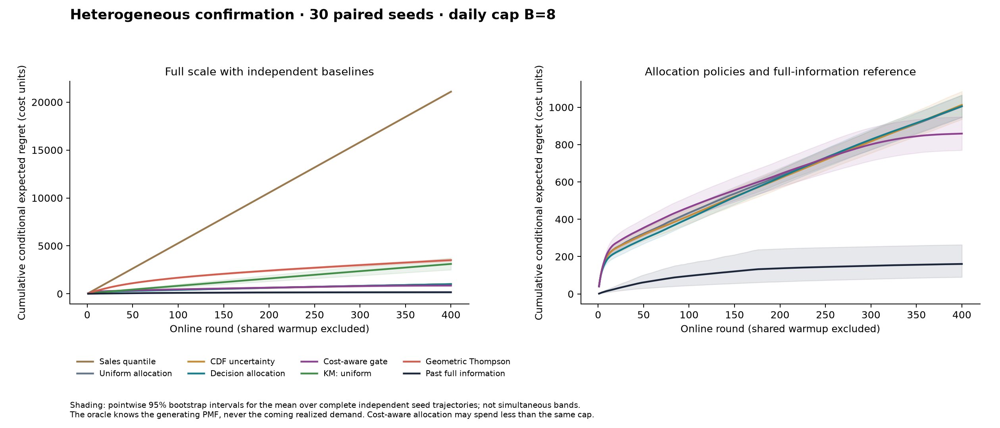
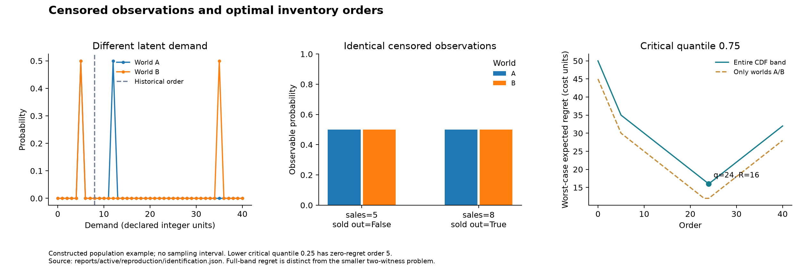
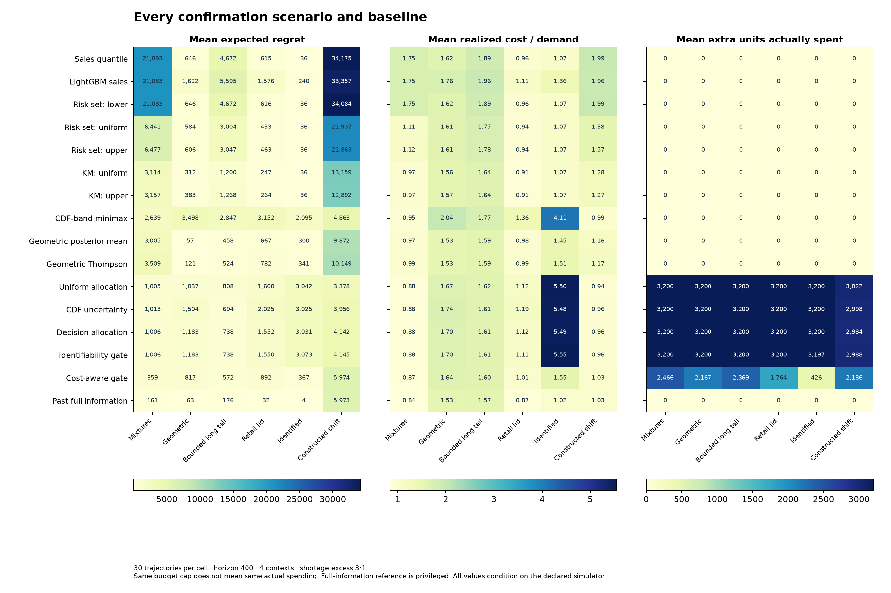

# Fresh Demand: inventory learning from censored sales

Inventory policies learn demand from sales limited by stock. Experiments test
whether allocating extra stock to informative contexts reduces ordering cost.
They use known synthetic distributions and distributions fitted to selected
retail records; they do not estimate real lost demand or policy effects.

## Confirmation results

The predeclared primary comparison is fixed-budget **decision versus uniform**
allocation on heterogeneous demand. Cumulative expected-regret difference:
**+0.91 [-58.26, 59.81]**, candidate minus baseline, with a paired 95% interval.
The interval includes zero; there is no clear advantage over uniform allocation. The comparison with allocation based on CDF uncertainty
is **-6.79 [-83.54, 80.13]**. Both comparisons were fixed before confirmation.

| Scenario | Decision − uniform, 95% CI | Decision − uncertainty, 95% CI |
| --- | --- | --- |
| heterogeneous | +0.91 [-58.26, 59.81] | -6.79 [-83.54, 80.13] |
| geometric | +146.76 [92.45, 199.51] | -320.31 [-409.36, -238.35] |
| heavy_tail | -70.07 [-127.39, -11.59] | +43.48 [-11.00, 96.00] |
| fresh_empirical | -48.28 [-91.55, -6.99] | -473.13 [-547.54, -395.83] |
| identified | -11.46 [-16.82, -4.19] | +5.29 [4.13, 6.44] |
| shift | +763.95 [380.66, 1,171.62] | +186.36 [-335.15, 717.62] |

Negative differences favor decision allocation. Intervals resample complete
paired trajectories. Secondary intervals are descriptive and are not adjusted
for multiple comparisons. All results depend on the stated demand distributions
and protocol.



## Methods

- A risk-set estimator counts `D <= d` only when order `Q > d` reveals that
  event. Its anytime Hoeffding bands require stationary independent demand
  within fixed contexts and orders chosen before observing current demand.
- An exact minimax-regret calculation over all CDFs between the supplied bounds,
  computed in linear time and checked against independent linear programs.
- A decision score prioritizes information that reduces regret. An exact integer
  allocator distributes the budget. Uniform and CDF-width allocation use the
  same base orders and constraint. Mean-field planning uses expected counts,
  without a Bayesian value function or regret bound.
- The cost-aware policy can leave budget unused when estimated immediate cost
  exceeds the information benefit. Baselines: Kaplan–Meier, geometric Bayes and
  Thompson sampling with censored feedback, LightGBM, and alternative unknown-tail
  completions.

## Identifiability example

Two constructed demand laws yield identical sales and sold-out observations at
historical order 8. At critical quantile
0.25, order 5 has
zero regret across the entire population CDF band. At quantile
0.75, the full-band minimax order is
24 with regret 16;
restricting uncertainty to the two witness worlds gives regret
12. These minimize regret over different
ambiguity sets. The distributions and costs illustrate a published identification argument.



## Cost and stock allocation

Confirmation uses 30 independent seeds, 400
online rounds, 4 contexts per round, known support
0..40, and shortage:excess costs
3:1. Shared warmup: 40 rounds
at order 8; its costs are excluded equally. Every
online shortage and excess cost, including exploration stock, is charged.

| Policy | Expected regret | Realized cost | Fill rate | Extra units |
| --- | --- | --- | --- | --- |
| Sales quantile | 21,093.09 | 40,340 | 44.4% | 0 |
| LightGBM sales | 21,082.93 | 40,318 | 45.2% | 0 |
| KM: uniform | 3,113.50 | 22,387 | 77.1% | 0 |
| KM: upper | 3,156.83 | 22,434 | 77.1% | 0 |
| CDF-band minimax | 2,639.38 | 21,827 | 92.0% | 0 |
| Geometric Thompson | 3,508.66 | 22,740 | 89.2% | 0 |
| Uniform allocation | 1,004.81 | 20,230 | 87.3% | 3,200 |
| CDF uncertainty | 1,012.51 | 20,252 | 87.1% | 3,200 |
| Decision allocation | 1,005.72 | 20,232 | 87.2% | 3,200 |
| Cost-aware gate | 858.96 | 20,088 | 86.3% | 2,466 |
| Past full information | 160.55 | 19,345 | 85.6% | 0 |

Values are seed means in the heterogeneous scenario. The PMF oracle uses the
same action set without seeing next demand; the full-information learner sees
past demand. Fixed policies spend B=8 extra units when feasible.
The cost-aware policy uses the same cap but spends 2,466
mean extra units versus 3,200 for uniform. This secondary
comparison allows different spending.


## Comparison with a myopic policy

This comparison was added after confirmation, using new seeds
4000–4019 and the unchanged cost-aware policy.
The myopic policy uses the same estimated demand distribution and budget cap,
but optimizes only immediate cost. On heterogeneous demand, cost-aware minus myopic
regret is **-9,643.05 [-11,722.22, -7,540.05]** and realized cost is **-9,776.30 [-11,915.21, -7,646.54]**.
The cost-aware policy has lower expected regret in this scenario. It has higher expected regret than the myopic policy in Geometric, Retail iid, Identified. This is a secondary analysis.




## Data and limitations

Retail contexts use 10,000 training-only store–product pairs.
Clustering features use 28 days; empirical demand PMFs use
379,138 fully stocked rows from 69 days
(2024-03-28–2024-06-04). A single scale factor based on
context-specific 99th percentiles, followed by rounding and clipping, sets the
integer support. The clipped-row fraction is
0.0633%. Zero empirical probabilities
remain zero. Demand is resampled independently within each context. Stock
availability depends on demand, so fully stocked records are a selected subset;
they do not identify demand during natural stockouts.

Real data lack historical inventory thresholds and assignment propensities.
Known order thresholds, bounded support, costs, context frequencies, and shifts
are simulator assumptions. CDF guarantees apply only under their stationary
conditions; constructed shift is an empirical stress test. Empty confidence
sets cause the experiment runner to log a fallback to uniform allocation.
The CLI refuses a recommendation when the confidence set is empty. Costs use
scenario units; the model does not represent currency or product shelf life.

## Reproduce

Run these commands from the repository root.

```bash
uv venv --python 3.12
source .venv/bin/activate
uv pip install -r requirements-lock.txt
uv pip install ".[dev]"
fresh-demand download --data-dir data/raw
python scripts/build_active_contexts.py --train-file data/raw/train.parquet --series-file reports/main/sampled_series.parquet --output reports/active/context_model.json --scale-mode tail_guard
fresh-demand active-reproduce --output reports/reproduction_active/reproduction
fresh-demand active-run --config configs/active/development.json --output reports/reproduction_active/development
fresh-demand active-select --development reports/reproduction_active/development --config configs/active/development.json --output reports/reproduction_active/frozen_selection.json
fresh-demand active-run --config configs/active/confirmation.json --selection reports/reproduction_active/frozen_selection.json --output reports/reproduction_active/confirmation
fresh-demand active-grid --config configs/active/phase_grid.json --selection reports/reproduction_active/frozen_selection.json --output reports/reproduction_active/phase_grid
fresh-demand active-run --config configs/active/mechanism_check.json --selection reports/reproduction_active/frozen_selection.json --output reports/reproduction_active/mechanism_check
python scripts/write_active_report.py --report-dir reports/reproduction_active/confirmation --selection reports/reproduction_active/frozen_selection.json --reproduction reports/reproduction_active/reproduction/identification.json --phase-grid reports/reproduction_active/phase_grid/summary.json --mechanism-check reports/reproduction_active/mechanism_check/summary.json
fresh-demand active-plan --history reports/active/service_demo/history.csv --config configs/active/confirmation.json --selection reports/reproduction_active/frozen_selection.json --output reports/reproduction_active/next_orders.json --policy adaptive_cost --seed 42
pytest -q
```

Existing completed runs are preserved; use fresh output directories when
rerunning. The serving demo replays a complete known-order censored log; raw
FreshRetail stock flags cannot substitute for historical inventory thresholds.
Development seeds [0, 1, 2, 3] and confirmation
seeds 1000..1029 are disjoint. Planning batch
64 was frozen on development outcomes. The
[protocol](docs/experimental_protocol.md) records the cost-aware policy added during development.
The [research report](docs/research_report.md) contains every policy,
coverage diagnostics, spending, and evidence paths; [identification](docs/identification.md)
gives the exact scope and proof. The [forecasting and Chronos baseline](docs/baseline_forecasting.md)
is documented separately. [Russian notes](docs/interview_notes_ru.md) cover the
decision problem, implementation, and interview discussion.

Related work: [Kumar–Mouchtaki (2026)](https://arxiv.org/abs/2602.16842)
and [Mukherjee et al. (2026)](https://arxiv.org/abs/2605.14840).
The project implements and evaluates methods without new theoretical claims.
[FreshRetailNet-50K](https://huggingface.co/datasets/Dingdong-Inc/FreshRetailNet-50K)
is CC BY 4.0. Independently written software is [MIT](LICENSE).

Tests: **109 passed**, 0 failures, 0 errors, and 0 skips; [test_summary.json](reports/active/test_summary.json).
