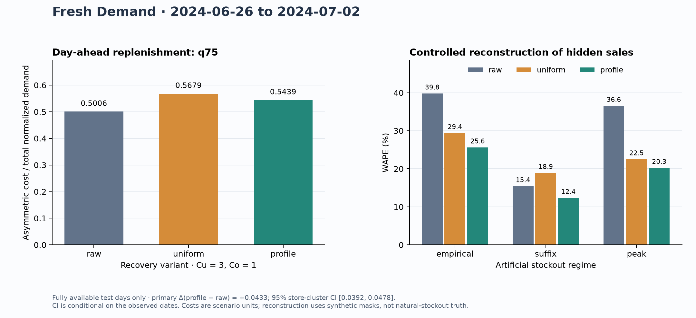

# Demand forecasting baseline

Day-ahead forecasting of fresh-retail demand with corrections for historical
stockouts. The experiment compares raw sales, correction by available hours,
and correction by the hourly demand profile. LightGBM quantiles determine
single-period order quantities.

During stockouts, observed sales are a lower bound on demand. Corrected demand
is an estimate and is evaluated separately from observed sales.

On fully available test days, raw LightGBM q50 has
**29.98% WAPE**, versus 32.14%
for the trailing mean and 39.84% for seasonal lag 7.
Using q75 instead of q50 for the raw model reduces scenario cost by
**21.08%** at a 3:1 shortage:excess cost ratio; fill rate
changes from **83.27% to 93.18%**.
Validation selected **raw**. Profile recovery has
8.65% higher test order cost than raw.



## Held-out results

The run samples **10,000 store–product pairs** from
official training identifiers (seed 42); it contains
900,000 training rows across 890
stores. Test dates: **2024-06-26–2024-07-02**, 7 days.
Scoring uses 41,220 fully available rows out of
70,000 test rows, across 890 scored stores.

| Model | Point WAPE | Point bias | Order cost | Fill rate |
| --- | --- | --- | --- | --- |
| Seasonal lag 7 | 39.84% | +0.09% | 0.7959 | 80.13% |
| Trailing mean 7 | 32.14% | -1.00% | 0.6529 | 83.43% |
| LightGBM raw | 29.98% | -3.47% | 0.5006 | 93.18% |
| LightGBM uniform | 32.36% | +10.63% | 0.5679 | 96.06% |
| LightGBM profile | 31.12% | +6.95% | 0.5439 | 95.48% |

LightGBM point metrics use q50; its order metrics use q75. The two simple
baselines use the same point forecast as their order quantity. WAPE and bias
are percentages; positive bias means overprediction. Cost is total
`3 × shortage + 1 × excess` divided by total scored demand. Fill rate is total
fulfilled demand divided by total demand. These are normalized scenario units.

**Predeclared comparison, profile versus raw:** q75 cost difference
**+0.0433**, with 95% paired store-cluster
interval **[0.0392, 0.0478]**;
negative favors profile. This primary comparison was fixed before model
selection. The interval is conditional on the observed dates,
using 2,000 bootstrap draws; it does not quantify future-date
uncertainty.

The secondary comparison of q75 with q50 orders gives cost difference -0.1337, with 95% store-cluster interval [-0.1410, -0.1262], conditional on the same dates. Source: [`policy_comparison.json`](../reports/main/policy_comparison.json).

## Validation and deployment selection

| Validation dates | Raw cost | Uniform cost | Profile cost |
| --- | --- | --- | --- |
| 2024-06-05–2024-06-11 | 0.5700 | 0.6531 | 0.6196 |
| 2024-06-12–2024-06-18 | 0.5562 | 0.6428 | 0.6163 |
| 2024-06-19–2024-06-25 | 0.5265 | 0.5828 | 0.5635 |
| Arithmetic fold mean | 0.5509 | 0.6262 | 0.5998 |

The lowest arithmetic mean validation cost selected **raw**
before training read the official evaluation file. Three expanding
validation windows precede the final test; the configuration fixes
250 trees, with no test-tuned early stopping. Quantile
crossings are corrected by sorting each row's quantile predictions.

Recovery profiles and priors use only the first 28 days and
remain frozen. Forecast models refit at each weekly origin; actual preceding
days update lag features within each scoring window. Each day receives a new
**H=1 forecast**; the model does not forecast the entire week from one origin. Same-day realized
weather, discounts, stock flags, and sales are excluded from forecast features.

## Recovery check and cost assumptions

Known sales on 41,220 fully available store–product days are
artificially hidden. Empirical masks come from training, suffix masks hide the
last four operational hours, and the fixed peak scenario hides predeclared
hours. Evaluation sales never determine mask placement.

| Mask regime | Raw WAPE | Uniform WAPE | Profile WAPE |
| --- | --- | --- | --- |
| empirical | 39.81% | 29.40% | 25.64% |
| suffix | 15.44% | 18.93% | 12.36% |
| peak | 36.58% | 22.52% | 20.27% |

These tests measure recovery under artificial masks. True demand during natural
stockouts remains unknown. Cost-ratio sensitivity uses the corresponding
quantile for each ratio; the deployed variant remains the validation selection:

| Shortage:excess cost | Raw cost | Uniform cost | Profile cost |
| --- | --- | --- | --- |
| 1:1 | 0.2998 | 0.3236 | 0.3112 |
| 3:1 | 0.5006 | 0.5679 | 0.5439 |
| 9:1 | 0.7461 | 0.8949 | 0.8401 |

## Reproduce

Python 3.12.15; package versions: numpy 2.5.4, polars 2.1.0, lightgbm 4.7.0, scikit-learn 1.9.1, pyarrow 26.0.0.
Elapsed main-run time: 187.5 seconds.
On macOS, LightGBM also requires OpenMP (`brew install libomp`).

```bash
uv venv --python 3.12
source .venv/bin/activate
uv pip install -r requirements-lock.txt
uv pip install -e ".[dev]"
fresh-demand download --data-dir data/raw
fresh-demand audit data/raw/train.parquet --output reports/train_audit.json
pytest -q

# Validation only: no held-out evaluation data is read.
fresh-demand train --data-dir data/raw --config configs/default.json --output reports/validation

# A fresh output directory preserves the existing frozen results.
fresh-demand train --data-dir data/raw --config configs/default.json --output reports/reproduction --final-test
python scripts/write_report.py --report-dir reports/reproduction

fresh-demand subset --input data/raw/train.parquet --series reports/reproduction/sampled_series.parquet --output data/history_cohort.parquet
fresh-demand predict --model reports/reproduction/artifacts/model.pkl --history data/history_cohort.parquet --output forecasts/next_day.parquet
fresh-demand retrain --history data/history_cohort.parquet --selection reports/reproduction/frozen_selection.json --config configs/default.json --model reports/reproduction/artifacts/retrained.pkl
```

`--final-test` creates the deployment bundle; validation-only training does not.
Prediction history follows the source schema and contains consecutive completed
days. For the original cohort, filter history using `sampled_series.parquet`.
Retraining uses the saved selection. Model bundles are excluded from Git and
can be regenerated locally or loaded from the supplied artifact. Optional Chronos
inference uses a separate locked environment and the same sampled cohort:

```bash
uv venv --python 3.12 .venv-chronos
uv pip install --python .venv-chronos/bin/python -r requirements-chronos-lock.txt
.venv-chronos/bin/python scripts/benchmark_chronos.py --data-dir data/raw --predictions reports/reproduction/test_predictions.parquet --series-file reports/reproduction/sampled_series.parquet --output reports/reproduction/chronos.json --max-series 256 --threads 4 --cache-dir .cache/hf
python scripts/write_report.py --report-dir reports/reproduction
```

## Evidence and limitations

Results are generated from [`run_summary.json`](../reports/main/run_summary.json)
and [`recovery_test.json`](../reports/main/recovery_test.json). These
record data/config hashes, selection, package versions, counts, and scores.
Dataset revision: `c374e85975c82816c495acfa904cc55ab14a47d3`. The downloader pins public
files and verifies their hashes. Raw data and binary model artifacts are ignored.

Evaluation uses fully stocked days, which may have a different demand distribution
from stockout days. The seven-day test does not establish performance stability
over longer periods. Positive sales can coexist
with stock flags, so treating flagged hours as entirely unavailable is an
approximation. Fixed warmup profiles can drift; shrinkage, exposure floors,
and recovery caps are heuristic assumptions. Costs use scenario units. The model
does not represent monetary profit, actual spoilage, shelf life, multi-period
inventory, or causal inventory effects. Details are in the
[methodology](methodology.md).

## Chronos-2 comparison

Chronos-2 and the baselines are evaluated on the same 256 sampled series
and 1,096 fully available rows on 2024-06-26–2024-07-02. Inference runs on CPU without
fine-tuning. Each H=1 forecast uses the updated history of raw sales, without
covariates or cross-series learning. Chronos-2 is excluded from deployment selection.

| Same-cohort model | Point WAPE | Bias | q75 cost |
| --- | --- | --- | --- |
| Seasonal lag 7 | 44.36% | +4.12% | — |
| Trailing mean 7 | 36.08% | +1.96% | — |
| LightGBM raw | 31.47% | +0.37% | 0.5374 |
| LightGBM profile | 33.93% | +10.84% | 0.6096 |
| Chronos-2 | 33.44% | -3.10% | 0.5837 |

Inference time: 1.8 seconds. Overlap with
pretraining data was not independently checked, so this is not verified as an
unseen-dataset evaluation. Source: [`chronos.json`](../reports/main/chronos.json).

## Data, related work, and license

[FreshRetailNet-50K](https://huggingface.co/datasets/Dingdong-Inc/FreshRetailNet-50K)
is released by Dingdong-Inc under **CC BY 4.0**; see the
[dataset paper](https://arxiv.org/abs/2505.16319) and
[official baseline](https://github.com/Dingdong-Inc/frn-50k-baseline).
[Azar's pipeline](https://www.mdpi.com/2411-5134/11/5/89) is closely related prior
work on recovery, forecasting, and replenishment. This project compares
implementations and evaluation procedures; it does not propose a new method.
Code is [MIT](../LICENSE); dataset licensing is
separate.
