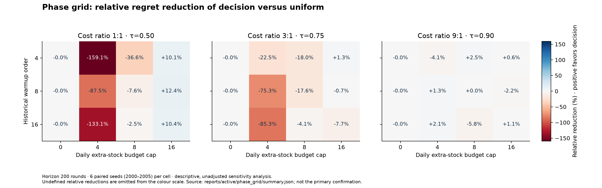

# Confirmation research report

This file is generated from `reports/active/confirmation/summary.json` and
`reports/active/confirmation/outcomes.csv`. No model is trained by the report script.
Configuration hash: `1bd8b39b9469ba37bdc6f57844169e633e3a8caf50b7caa5fd0dc0d13a0acc13`; context hash:
`c504f44652f6c39f157a62a9c8a272d74e6f88262fc5b6c20223ba25fb9d8b2e`; frozen-selection hash:
`ef9673e1eeef2463fc03ed4125b8354dbab36ef8ce0fe2d17144adce4507d008`. Runtime: 320.3 seconds.

## Predeclared comparisons

| Scenario | Decision − uniform, 95% CI | Decision − uncertainty, 95% CI |
| --- | --- | --- |
| heterogeneous | +0.91 [-58.26, 59.81] | -6.79 [-83.54, 80.13] |
| geometric | +146.76 [92.45, 199.51] | -320.31 [-409.36, -238.35] |
| heavy_tail | -70.07 [-127.39, -11.59] | +43.48 [-11.00, 96.00] |
| fresh_empirical | -48.28 [-91.55, -6.99] | -473.13 [-547.54, -395.83] |
| identified | -11.46 [-16.82, -4.19] | +5.29 [4.13, 6.44] |
| shift | +763.95 [380.66, 1,171.62] | +186.36 [-335.15, 717.62] |

Primary conclusion: The interval includes zero; the primary comparison does not establish a clear advantage. Difference means candidate minus
baseline in cumulative conditional expected regret. The comparator is the
PMF-optimal order from the same finite action set, not a clairvoyant observing
coming realized demand. Paired intervals resample entire independent demand
seeds and preserve every round/context. Secondary comparisons are descriptive.

## Full policy results

Every configured policy is shown, including unfavourable outcomes. Costs below
are realized scenario cost totals; normalized-cost and coverage diagnostics
follow in a separate table. Means across seeds do not constitute claims about
an unspecified population of environments. Every policy also accumulates a
risk-set CDF band from its own observations for the same auxiliary coverage
diagnostic; this is not a separate coverage claim for a Kaplan–Meier or Bayesian
point predictor.

## heterogeneous

| Policy | Expected regret | Realized cost | Fill rate | Extra units |
| --- | --- | --- | --- | --- |
| Sales quantile | 21,093.09 | 40,340 | 44.4% | 0 |
| LightGBM sales | 21,082.93 | 40,318 | 45.2% | 0 |
| Risk set: lower | 21,083.30 | 40,327 | 44.4% | 0 |
| Risk set: uniform | 6,440.53 | 25,694 | 69.9% | 0 |
| Risk set: upper | 6,477.33 | 25,728 | 70.0% | 0 |
| KM: uniform | 3,113.50 | 22,387 | 77.1% | 0 |
| KM: upper | 3,156.83 | 22,434 | 77.1% | 0 |
| CDF-band minimax | 2,639.38 | 21,827 | 92.0% | 0 |
| Geometric posterior mean | 3,005.34 | 22,226 | 89.4% | 0 |
| Geometric Thompson | 3,508.66 | 22,740 | 89.2% | 0 |
| Uniform allocation | 1,004.81 | 20,230 | 87.3% | 3,200 |
| CDF uncertainty | 1,012.51 | 20,252 | 87.1% | 3,200 |
| Decision allocation | 1,005.72 | 20,232 | 87.2% | 3,200 |
| Identifiability gate | 1,005.72 | 20,232 | 87.2% | 3,200 |
| Cost-aware gate | 858.96 | 20,088 | 86.3% | 2,466 |
| Past full information | 160.55 | 19,345 | 85.6% | 0 |

| Policy | Mean cost/demand | Seeds with path coverage | Final identified fraction | Fallback rounds |
| --- | --- | --- | --- | --- |
| Sales quantile | 1.751 | 100.0% | 0.0% | 0.00 |
| LightGBM sales | 1.750 | 100.0% | 0.0% | 0.00 |
| Risk set: lower | 1.750 | 100.0% | 0.0% | 0.00 |
| Risk set: uniform | 1.115 | 100.0% | 0.0% | 0.00 |
| Risk set: upper | 1.116 | 100.0% | 0.0% | 0.00 |
| KM: uniform | 0.971 | 100.0% | 0.0% | 0.00 |
| KM: upper | 0.973 | 100.0% | 0.0% | 0.00 |
| CDF-band minimax | 0.948 | 100.0% | 0.0% | 0.00 |
| Geometric posterior mean | 0.965 | 100.0% | 0.0% | 0.00 |
| Geometric Thompson | 0.987 | 100.0% | 0.0% | 0.00 |
| Uniform allocation | 0.878 | 100.0% | 0.0% | 0.00 |
| CDF uncertainty | 0.879 | 100.0% | 0.0% | 0.00 |
| Decision allocation | 0.879 | 100.0% | 0.0% | 0.00 |
| Identifiability gate | 0.879 | 100.0% | 0.0% | 0.00 |
| Cost-aware gate | 0.872 | 100.0% | 0.0% | 0.00 |
| Past full information | 0.840 | 100.0% | 0.0% | 0.00 |

Stationary confidence assumptions apply in this constructed environment. Coverage is measured before each online action and is a simulator diagnostic; final identification is measured at the last action's information set.

## geometric

| Policy | Expected regret | Realized cost | Fill rate | Extra units |
| --- | --- | --- | --- | --- |
| Sales quantile | 645.67 | 10,985 | 61.5% | 0 |
| LightGBM sales | 1,621.54 | 11,952 | 56.6% | 0 |
| Risk set: lower | 645.67 | 10,985 | 61.5% | 0 |
| Risk set: uniform | 584.50 | 10,910 | 62.7% | 0 |
| Risk set: upper | 606.12 | 10,933 | 62.7% | 0 |
| KM: uniform | 312.45 | 10,612 | 68.6% | 0 |
| KM: upper | 383.04 | 10,683 | 68.5% | 0 |
| CDF-band minimax | 3,497.82 | 13,823 | 88.3% | 0 |
| Geometric posterior mean | 57.38 | 10,363 | 73.1% | 0 |
| Geometric Thompson | 121.18 | 10,413 | 73.3% | 0 |
| Uniform allocation | 1,036.70 | 11,364 | 80.9% | 3,200 |
| CDF uncertainty | 1,503.78 | 11,829 | 76.2% | 3,200 |
| Decision allocation | 1,183.47 | 11,532 | 78.5% | 3,200 |
| Identifiability gate | 1,183.47 | 11,532 | 78.5% | 3,200 |
| Cost-aware gate | 817.35 | 11,142 | 75.9% | 2,167 |
| Past full information | 62.53 | 10,376 | 72.9% | 0 |

| Policy | Mean cost/demand | Seeds with path coverage | Final identified fraction | Fallback rounds |
| --- | --- | --- | --- | --- |
| Sales quantile | 1.617 | 100.0% | 0.0% | 0.00 |
| LightGBM sales | 1.760 | 100.0% | 0.0% | 0.00 |
| Risk set: lower | 1.617 | 100.0% | 0.0% | 0.00 |
| Risk set: uniform | 1.607 | 100.0% | 0.0% | 0.00 |
| Risk set: upper | 1.610 | 100.0% | 0.0% | 0.00 |
| KM: uniform | 1.563 | 100.0% | 0.0% | 0.00 |
| KM: upper | 1.573 | 100.0% | 0.0% | 0.00 |
| CDF-band minimax | 2.036 | 100.0% | 0.0% | 0.00 |
| Geometric posterior mean | 1.526 | 100.0% | 0.0% | 0.00 |
| Geometric Thompson | 1.533 | 100.0% | 0.0% | 0.00 |
| Uniform allocation | 1.674 | 100.0% | 0.0% | 0.00 |
| CDF uncertainty | 1.742 | 100.0% | 0.0% | 0.00 |
| Decision allocation | 1.698 | 100.0% | 0.0% | 0.00 |
| Identifiability gate | 1.698 | 100.0% | 0.0% | 0.00 |
| Cost-aware gate | 1.641 | 100.0% | 0.0% | 0.00 |
| Past full information | 1.528 | 100.0% | 0.0% | 0.00 |

Stationary confidence assumptions apply in this constructed environment. Coverage is measured before each online action and is a simulator diagnostic; final identification is measured at the last action's information set.

## heavy_tail

| Policy | Expected regret | Realized cost | Fill rate | Extra units |
| --- | --- | --- | --- | --- |
| Sales quantile | 4,672.10 | 26,167 | 45.3% | 0 |
| LightGBM sales | 5,595.41 | 27,122 | 49.2% | 0 |
| Risk set: lower | 4,672.10 | 26,167 | 45.3% | 0 |
| Risk set: uniform | 3,004.24 | 24,596 | 52.3% | 0 |
| Risk set: upper | 3,047.31 | 24,637 | 52.4% | 0 |
| KM: uniform | 1,199.55 | 22,720 | 62.8% | 0 |
| KM: upper | 1,267.68 | 22,778 | 62.9% | 0 |
| CDF-band minimax | 2,846.59 | 24,504 | 84.2% | 0 |
| Geometric posterior mean | 458.39 | 22,004 | 68.2% | 0 |
| Geometric Thompson | 524.32 | 22,059 | 68.4% | 0 |
| Uniform allocation | 807.75 | 22,381 | 74.1% | 3,200 |
| CDF uncertainty | 694.21 | 22,290 | 73.6% | 3,200 |
| Decision allocation | 737.68 | 22,296 | 73.7% | 3,200 |
| Identifiability gate | 737.68 | 22,296 | 73.7% | 3,200 |
| Cost-aware gate | 572.01 | 22,135 | 71.7% | 2,369 |
| Past full information | 176.03 | 21,732 | 71.3% | 0 |

| Policy | Mean cost/demand | Seeds with path coverage | Final identified fraction | Fallback rounds |
| --- | --- | --- | --- | --- |
| Sales quantile | 1.888 | 100.0% | 0.0% | 0.00 |
| LightGBM sales | 1.958 | 100.0% | 0.0% | 0.00 |
| Risk set: lower | 1.888 | 100.0% | 0.0% | 0.00 |
| Risk set: uniform | 1.775 | 100.0% | 0.0% | 0.00 |
| Risk set: upper | 1.778 | 100.0% | 0.0% | 0.00 |
| KM: uniform | 1.641 | 100.0% | 0.0% | 0.00 |
| KM: upper | 1.645 | 100.0% | 0.0% | 0.00 |
| CDF-band minimax | 1.770 | 100.0% | 0.0% | 0.00 |
| Geometric posterior mean | 1.589 | 100.0% | 0.0% | 0.00 |
| Geometric Thompson | 1.593 | 100.0% | 0.0% | 0.00 |
| Uniform allocation | 1.616 | 100.0% | 0.0% | 0.00 |
| CDF uncertainty | 1.610 | 100.0% | 0.0% | 0.00 |
| Decision allocation | 1.610 | 100.0% | 0.0% | 0.00 |
| Identifiability gate | 1.610 | 100.0% | 0.0% | 0.00 |
| Cost-aware gate | 1.598 | 100.0% | 0.0% | 0.00 |
| Past full information | 1.570 | 100.0% | 0.0% | 0.00 |

Stationary confidence assumptions apply in this constructed environment. Coverage is measured before each online action and is a simulator diagnostic; final identification is measured at the last action's information set.

## fresh_empirical

| Policy | Expected regret | Realized cost | Fill rate | Extra units |
| --- | --- | --- | --- | --- |
| Sales quantile | 615.26 | 6,271 | 76.9% | 0 |
| LightGBM sales | 1,576.26 | 7,224 | 72.0% | 0 |
| Risk set: lower | 615.60 | 6,271 | 76.9% | 0 |
| Risk set: uniform | 452.79 | 6,118 | 78.7% | 0 |
| Risk set: upper | 463.27 | 6,127 | 78.8% | 0 |
| KM: uniform | 247.22 | 5,912 | 81.3% | 0 |
| KM: upper | 264.01 | 5,929 | 81.3% | 0 |
| CDF-band minimax | 3,151.63 | 8,834 | 93.0% | 0 |
| Geometric posterior mean | 667.22 | 6,355 | 90.3% | 0 |
| Geometric Thompson | 781.57 | 6,458 | 90.4% | 0 |
| Uniform allocation | 1,600.11 | 7,285 | 90.6% | 3,200 |
| CDF uncertainty | 2,024.96 | 7,705 | 86.6% | 3,200 |
| Decision allocation | 1,551.83 | 7,249 | 89.9% | 3,200 |
| Identifiability gate | 1,549.76 | 7,244 | 89.9% | 3,200 |
| Cost-aware gate | 892.01 | 6,570 | 87.0% | 1,764 |
| Past full information | 31.64 | 5,686 | 84.5% | 0 |

| Policy | Mean cost/demand | Seeds with path coverage | Final identified fraction | Fallback rounds |
| --- | --- | --- | --- | --- |
| Sales quantile | 0.964 | 100.0% | 0.0% | 0.00 |
| LightGBM sales | 1.112 | 100.0% | 0.0% | 0.00 |
| Risk set: lower | 0.964 | 100.0% | 0.0% | 0.00 |
| Risk set: uniform | 0.941 | 100.0% | 0.0% | 0.00 |
| Risk set: upper | 0.942 | 100.0% | 0.0% | 0.00 |
| KM: uniform | 0.909 | 100.0% | 0.0% | 0.00 |
| KM: upper | 0.912 | 100.0% | 0.0% | 0.00 |
| CDF-band minimax | 1.360 | 100.0% | 0.0% | 0.00 |
| Geometric posterior mean | 0.978 | 100.0% | 5.8% | 0.00 |
| Geometric Thompson | 0.994 | 100.0% | 3.3% | 0.00 |
| Uniform allocation | 1.121 | 100.0% | 8.3% | 0.00 |
| CDF uncertainty | 1.186 | 100.0% | 9.2% | 0.00 |
| Decision allocation | 1.116 | 100.0% | 6.7% | 0.00 |
| Identifiability gate | 1.115 | 100.0% | 7.5% | 0.00 |
| Cost-aware gate | 1.011 | 100.0% | 0.0% | 0.00 |
| Past full information | 0.875 | 100.0% | 0.0% | 0.00 |

Stationary confidence assumptions apply in this constructed environment. Coverage is measured before each online action and is a simulator diagnostic; final identification is measured at the last action's information set.

## identified

| Policy | Expected regret | Realized cost | Fill rate | Extra units |
| --- | --- | --- | --- | --- |
| Sales quantile | 36.27 | 721 | 87.7% | 0 |
| LightGBM sales | 240.00 | 922 | 100.0% | 0 |
| Risk set: lower | 36.27 | 721 | 87.7% | 0 |
| Risk set: uniform | 36.27 | 721 | 87.7% | 0 |
| Risk set: upper | 36.27 | 721 | 87.7% | 0 |
| KM: uniform | 36.27 | 721 | 87.7% | 0 |
| KM: upper | 36.27 | 721 | 87.7% | 0 |
| CDF-band minimax | 2,095.17 | 2,782 | 97.5% | 0 |
| Geometric posterior mean | 300.16 | 985 | 92.7% | 0 |
| Geometric Thompson | 340.73 | 1,025 | 93.5% | 0 |
| Uniform allocation | 3,042.22 | 3,724 | 99.3% | 3,200 |
| CDF uncertainty | 3,025.47 | 3,708 | 100.0% | 3,200 |
| Decision allocation | 3,030.76 | 3,713 | 99.8% | 3,200 |
| Identifiability gate | 3,073.16 | 3,758 | 98.0% | 3,197 |
| Cost-aware gate | 367.45 | 1,049 | 95.2% | 426 |
| Past full information | 3.88 | 691 | 93.2% | 0 |

| Policy | Mean cost/demand | Seeds with path coverage | Final identified fraction | Fallback rounds |
| --- | --- | --- | --- | --- |
| Sales quantile | 1.065 | 100.0% | 0.0% | 0.00 |
| LightGBM sales | 1.363 | 100.0% | 23.3% | 0.00 |
| Risk set: lower | 1.065 | 100.0% | 0.0% | 0.00 |
| Risk set: uniform | 1.065 | 100.0% | 0.0% | 0.00 |
| Risk set: upper | 1.065 | 100.0% | 0.0% | 0.00 |
| KM: uniform | 1.065 | 100.0% | 0.0% | 0.00 |
| KM: upper | 1.065 | 100.0% | 0.0% | 0.00 |
| CDF-band minimax | 4.109 | 100.0% | 0.0% | 0.00 |
| Geometric posterior mean | 1.455 | 100.0% | 27.5% | 0.00 |
| Geometric Thompson | 1.514 | 100.0% | 30.8% | 0.00 |
| Uniform allocation | 5.501 | 100.0% | 69.2% | 0.00 |
| CDF uncertainty | 5.477 | 100.0% | 73.3% | 0.00 |
| Decision allocation | 5.485 | 100.0% | 72.5% | 0.00 |
| Identifiability gate | 5.552 | 100.0% | 73.3% | 0.00 |
| Cost-aware gate | 1.550 | 100.0% | 0.0% | 0.00 |
| Past full information | 1.021 | 100.0% | 0.0% | 0.00 |

Stationary confidence assumptions apply in this constructed environment. Coverage is measured before each online action and is a simulator diagnostic; final identification is measured at the last action's information set.

## shift

| Policy | Expected regret | Realized cost | Fill rate | Extra units |
| --- | --- | --- | --- | --- |
| Sales quantile | 34,174.94 | 58,048 | 35.6% | 0 |
| LightGBM sales | 33,356.68 | 57,231 | 36.9% | 0 |
| Risk set: lower | 34,083.83 | 57,954 | 35.7% | 0 |
| Risk set: uniform | 21,936.87 | 45,912 | 53.6% | 0 |
| Risk set: upper | 21,863.16 | 45,837 | 53.8% | 0 |
| KM: uniform | 13,158.56 | 37,180 | 66.1% | 0 |
| KM: upper | 12,892.26 | 36,892 | 66.6% | 0 |
| CDF-band minimax | 4,863.23 | 28,806 | 87.4% | 0 |
| Geometric posterior mean | 9,871.72 | 33,862 | 79.0% | 0 |
| Geometric Thompson | 10,148.80 | 34,165 | 79.0% | 0 |
| Uniform allocation | 3,378.29 | 27,304 | 87.1% | 3,022 |
| CDF uncertainty | 3,955.88 | 27,918 | 86.1% | 2,998 |
| Decision allocation | 4,142.25 | 28,036 | 85.9% | 2,984 |
| Identifiability gate | 4,145.14 | 28,052 | 85.8% | 2,988 |
| Cost-aware gate | 5,973.55 | 29,933 | 80.3% | 2,186 |
| Past full information | 5,972.75 | 29,867 | 78.5% | 0 |

| Policy | Mean cost/demand | Seeds with path coverage | Final identified fraction | Fallback rounds |
| --- | --- | --- | --- | --- |
| Sales quantile | 1.992 | 0.0% | 0.0% | 0.00 |
| LightGBM sales | 1.964 | 0.0% | 0.0% | 0.00 |
| Risk set: lower | 1.989 | 0.0% | 0.0% | 0.00 |
| Risk set: uniform | 1.576 | 0.0% | 0.0% | 0.00 |
| Risk set: upper | 1.573 | 0.0% | 0.0% | 0.00 |
| KM: uniform | 1.275 | 0.0% | 0.0% | 0.00 |
| KM: upper | 1.266 | 0.0% | 0.0% | 0.00 |
| CDF-band minimax | 0.989 | 0.0% | 0.0% | 0.00 |
| Geometric posterior mean | 1.163 | 0.0% | 0.0% | 0.00 |
| Geometric Thompson | 1.173 | 0.0% | 0.0% | 0.00 |
| Uniform allocation | 0.938 | 0.0% | 0.0% | 0.00 |
| CDF uncertainty | 0.959 | 0.0% | 0.0% | 0.00 |
| Decision allocation | 0.963 | 0.0% | 0.0% | 0.00 |
| Identifiability gate | 0.964 | 0.0% | 0.0% | 21.57 |
| Cost-aware gate | 1.027 | 0.0% | 0.0% | 1.93 |
| Past full information | 1.025 | 0.0% | 0.0% | 0.00 |

This environment shifts; no stationary coverage guarantee applies. Coverage is measured before each online action and is a simulator diagnostic; final identification is measured at the last action's information set.

## Secondary cost-aware policy comparisons

These predefined descriptive contrasts use the same complete seed pairs, with 95% bootstrap intervals computed from outcomes.csv. Positive relative reduction favors the cost-aware policy. They are not multiplicity-adjusted and do not replace the fixed-budget primary result. The cost-aware policy has an at-most budget and may spend less.

| Scenario | Baseline | Regret Δ, 95% CI | Relative regret reduction | Realized-cost Δ, 95% CI | Relative cost reduction |
| --- | --- | --- | --- | --- | --- |
| heterogeneous | Uniform allocation | -145.85 [-227.39, -53.02] | 14.5% | -141.40 [-226.43, -49.00] | 0.7% |
| heterogeneous | KM: uniform | -2,254.54 [-2,846.69, -1,676.96] | 72.4% | -2,298.97 [-2,965.77, -1,660.17] | 10.3% |
| heterogeneous | Geometric Thompson | -2,649.70 [-2,813.95, -2,489.14] | 75.5% | -2,651.40 [-2,770.83, -2,524.06] | 11.7% |
| geometric | Uniform allocation | -219.35 [-281.50, -159.65] | 21.2% | -221.30 [-290.03, -152.76] | 1.9% |
| geometric | KM: uniform | +504.90 [407.80, 601.22] | -161.6% | +530.17 [407.47, 646.84] | -5.0% |
| geometric | Geometric Thompson | +696.17 [630.20, 765.50] | -574.5% | +729.53 [669.57, 791.57] | -7.0% |
| heavy_tail | Uniform allocation | -235.74 [-299.76, -168.54] | 29.2% | -246.13 [-329.33, -159.49] | 1.1% |
| heavy_tail | KM: uniform | -627.54 [-931.69, -350.35] | 52.3% | -584.17 [-880.84, -296.10] | 2.6% |
| heavy_tail | Geometric Thompson | +47.69 [-39.13, 132.33] | -9.1% | +76.10 [-15.85, 172.40] | -0.3% |
| fresh_empirical | Uniform allocation | -708.09 [-771.75, -644.52] | 44.3% | -714.97 [-777.94, -648.87] | 9.8% |
| fresh_empirical | KM: uniform | +644.80 [551.34, 736.80] | -260.8% | +657.93 [560.20, 755.10] | -11.1% |
| fresh_empirical | Geometric Thompson | +110.44 [38.44, 179.94] | -14.1% | +111.97 [44.33, 178.33] | -1.7% |
| identified | Uniform allocation | -2,674.76 [-2,688.09, -2,657.70] | 87.9% | -2,675.00 [-2,688.00, -2,660.03] | 71.8% |
| identified | KM: uniform | +331.18 [313.86, 347.47] | -913.2% | +327.97 [306.93, 347.40] | -45.5% |
| identified | Geometric Thompson | +26.72 [14.55, 38.83] | -7.8% | +23.30 [11.67, 35.30] | -2.3% |
| shift | Uniform allocation | +2,595.25 [2,153.68, 3,071.53] | -76.8% | +2,629.10 [2,082.16, 3,227.40] | -9.6% |
| shift | KM: uniform | -7,185.01 [-8,239.43, -6,209.51] | 54.6% | -7,246.73 [-8,317.80, -6,255.69] | 19.5% |
| shift | Geometric Thompson | -4,175.25 [-4,606.83, -3,727.32] | 41.1% | -4,231.67 [-4,720.90, -3,723.59] | 12.4% |

## Post-confirmation explanatory control

This additional check was designed after confirmation. The candidate algorithm,
frozen planning parameter, and primary outcome remain unchanged. The new
`myopic_cost` control uses the same uniform-tail working PMF and at-most-B
allocator, optimizing immediate fitted cost without information value.
It isolates a rival explanation: saving unnecessary stock can improve on a
forced-spending baseline without beneficial active information acquisition.

There are 20 new paired seeds, 4000 through
4019, with 400 rounds. The report independently
recomputes both metrics from [outcomes.csv](../reports/active/mechanism_check/outcomes.csv)
using complete seed-paired bootstrap draws. Positive relative reduction favors
the cost-aware candidate. Intervals are descriptive and unadjusted.

| Scenario | Regret Δ, 95% CI | Regret reduction | Realized-cost Δ, 95% CI | Cost reduction | Cost-aware extra | Myopic extra |
| --- | --- | --- | --- | --- | --- | --- |
| heterogeneous | -9,643.05 [-11,722.22, -7,540.05] | 91.3% | -9,776.30 [-11,915.21, -7,646.54] | 32.6% | 2,513.7 | 35.9 |
| geometric | +307.92 [192.59, 420.12] | -60.4% | +292.05 [187.00, 401.75] | -2.7% | 2,250.4 | 14.6 |
| heavy_tail | -2,933.75 [-3,399.69, -2,402.08] | 81.6% | -2,930.40 [-3,412.26, -2,382.14] | 11.5% | 2,393.2 | 26.8 |
| fresh_empirical | +396.94 [311.74, 493.89] | -80.8% | +399.60 [283.75, 528.17] | -6.5% | 1,877.7 | 11.4 |
| identified | +312.86 [290.22, 334.45] | -626.1% | +308.10 [282.15, 331.65] | -42.0% | 417.9 | 0.0 |
| shift | -18,817.99 [-20,360.47, -17,306.72] | 75.0% | -18,851.95 [-20,415.56, -17,325.34] | 38.2% | 2,241.9 | 35.7 |

Heterogeneous interpretation: Expected regret is lower than the myopic control on these new simulator trajectories; this is explanatory evidence, not a new primary test. Scope is the specified simulator;
this does not establish real operational value or a new finite-sample theorem.
Source: [summary.json](../reports/active/mechanism_check/summary.json).

## Identification and methodological boundaries

The full population ambiguity band gives order 24
and regret 16; only the two witness worlds
give regret 12. Neither is a
finite-sample confidence interval. Exact CDF-band optimization is verified
independently by LP; this does not reproduce the full finite-sample theorem in
Kumar–Mouchtaki. See [identification](identification.md) and [reproduction](reproduction.md).

Mean-field planning evaluates nonlinear regret at expected fractional counts;
it is not expected regret over future datasets. Unknown-tail completions are
working assumptions. The geometric baseline is correctly specified only for
the geometric control. Kaplan–Meier uses censored-before-event tie handling
under the declared D>=Q observation convention.

All policies observe one outcome from each context every round. Context
frequency and the extra-stock cap are experimental design choices. Fixed
allocation and at-most-budget cost gating are different interventions; actual
extra units and full costs must accompany claims about performance.

Stationary scenarios: heterogeneous, geometric, heavy_tail, fresh_empirical, identified. Under constructed shift, old
observations need not represent current demand and confidence coverage is not
asserted. Empty-polytope action fallbacks are counted. Even stationary
guarantees condition on the known finite support, fixed contexts, predictable
orders, independence, and the declared finite horizon.
The experiment runner may fall back to uniform allocation and logs this event;
the serving CLI fails closed on an empty confidence set instead of issuing a
recommendation under an invalid certificate.

Retail-derived PMFs describe selected fully stocked historical sales, scaled
and coarsened. They are not observed natural-stockout counterfactuals. Context
model provenance, clipping, and cluster sizes are in
[`context_model.json`](../reports/active/context_model.json). Official retail
evaluation outcomes are excluded from context construction.

## Reproducible evidence

- [Confirmation summary](../reports/active/confirmation/summary.json) and
  [complete per-seed results](../reports/active/confirmation/outcomes.csv).
- [Round-level trajectories](../reports/active/confirmation/learning_curves.parquet).
- [Frozen development selection](../reports/active/frozen_selection.json).
- [Constructed identification and fixed-audit study](../reports/active/reproduction/identification.json).
- [Experimental protocol and development amendment](experimental_protocol.md).
- [Former forecasting baseline](baseline_forecasting.md).

Software versions: {"lightgbm": "4.7.0", "numpy": "2.5.4", "polars": "2.1.0", "scikit-learn": "1.9.1", "scipy": "1.18.1"}.
These are fixed-simulator experiments with no claim of real operational ROI,
financial savings, identified latent demand, or new scientific theory.

## Source verification

The recorded simulation-core match is `True` against commit `7121c6c4e6e21a174dab5976be1e9c332f610459`. This check concerns the simulation core, not every repository source. The separately recorded auxiliary-source comparison includes serving changes after the run began; post-confirmation mechanism extensions are a separate stage. See [source_verification.json](../reports/active/confirmation/source_verification.json).

## Tests

Measured test evidence: **109 passed**, 0 failures, 0 errors, and 0 skips; [test_summary.json](../reports/active/test_summary.json).

## Serving replay

The saved known-order history reproduces the recorded order at round 100: exact match `True`, oracle inputs used `False`. This verifies replay of the declared censored-information interface; it does not identify a real retail policy. See [verification.json](../reports/active/service_demo/verification.json), [history.csv](../reports/active/service_demo/history.csv), [next_orders.json](../reports/active/service_demo/next_orders.json), and [decision_replay.json](../reports/active/service_demo/decision_replay.json).

## Exploratory phase grid

This grid is a sensitivity study; it does not replace the predeclared primary comparison. Source: [summary.json](../reports/active/phase_grid/summary.json).
